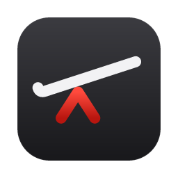

<p align="center">
  
</p>

<h1 align="center">Lever</h1>

<p align="center">
  A macOS app for running a project's dev services, terminals, Git worktrees and coding agents — all in one window.
</p>

<p align="center">
  <a href="https://github.com/Ilikecarpet/lever/releases/latest"></a>
  <a href="LICENSE"></a>
  
  <a href="https://v2.tauri.app"></a>
</p>

---

Lever replaces the mess of terminal tabs, hand-started services and scattered dev scripts with one window. Define your services once, group them, and start them with a click. Give each Git worktree its own copy of everything. Work with Claude Code or Codex in a terminal or in a native chat — and let them see and drive the same services you do.

## Features

**Service Management**
- Define services (long-running, like a dev server) and tasks (run to completion, like a build or migration) with a command, working directory and optional stop command
- Organize them into groups (e.g. "Backend", "Frontend", "Infrastructure") and start a whole group at once
- Live logs for every run, in a panel or a full terminal view
- Services outlive their windows: close a window and they keep running, reopen it and
  their output is still there (the newest 1 MB of each run)
- Listening ports collected in the status bar and clickable — no hunting for which port a dev server landed on

**Workspaces: terminals and chats**
- Each tab is a terminal or an agent chat; Settings → Workspaces picks which one `Cmd+T` opens, and `Cmd+Shift+T` opens the other
- Terminals are xterm.js, split vertically and horizontally, with a fresh shell if you `exit`
- Multiple workspaces per project and per worktree, with quick switching
- A plain scratch terminal from the start page, no project needed

**Agent Chats**
- Claude Code or Codex in a native chat pane, talked to over the [Agent Client Protocol](https://agentclientprotocol.com) — the same agents as in a terminal, with the same permission modes (Auto, Manual, Accept edits, Plan, Bypass)
- Tool calls fold into a one-line summary per step ("Read 2 files, edited 1 file +12 −3"); open one for each command's output, each file's diff, and what you approved
- Approvals appear above the composer with the command or diff they are for; answer with `1`/`2`/`3`
- Composer: `@` to mention a file (small text files go in whole, as `@` does in the CLI), `/` for the agent's commands, attach files and images by picker, drag-and-drop or paste, `↑` to recall what you sent, `Shift+Tab` to cycle permission modes, `Esc` to stop
- Mode, model and effort pickers, and a ring for how much of the context window is used
- The agent's plan as a live checklist; replies stream in with code blocks you can copy
- History: reopen any past conversation in the checkout, including ones started with `claude` in a terminal; recent ones on the welcome screen are those on the current branch
- A changes drawer listing every file the chat edited, each edit as its own diff, resizable up to half the chat, with a jump to the Git panel to stage them
- Needs Node.js on your shell's `PATH`; the first chat fetches the agent's ACP adapter with `npx`. Claude uses your Claude Code sign-in; Codex asks for ChatGPT or an API key the first time

**Agent Status**
- Chats and terminal agents are tracked alike: the worktree's branch row shows when an
  agent is working, names the conversation in the focused pane with the lines it has
  changed, and pulses when one finishes and nobody has been back — on the tab too, and
  the Dock bounces if Lever is in the background
- Live meter in the status bar for the Claude Code session in the focused terminal:
  model, context used, and plan usage left, side by side
- Breakdown of what fills the window — cached, newly written, fresh input, reply — and
  running session totals: turns, input/output tokens, cache reads and writes, subagent output
- Read from Claude Code's own session files; nothing is attached to the process
- Optional statusLine bridge for the exact context window (200k vs 1M), which is
  otherwise not recorded anywhere on disk — off by default, and it chains to any
  statusLine command you already use
- With the bridge on, the plan's 5-hour and 7-day usage as Claude Code reports it,
  with the time to each reset, plus the conversation's title and model name, running
  cost at API list price, lines changed, effort and fast-mode flags, and whether the
  prompt cache is still warm

**Agent Access (MCP)**
- Optional MCP server so an agent can see and drive your services — off by default,
  turned on in Settings → Agents, which also registers it with Claude Code
- Tools: `list_projects`, `list_services` (groups, services and tasks per checkout and
  worktree, with status, ports and last exit code), `get_logs`, `start_service`,
  `stop_service`, `restart_service`
- Logs are the output Lever keeps for each run, the same text its log panel shows, so
  the agent sees what you see, with or without a window open — newest lines by default,
  a line range (`from`/`to`), or only lines matching `contains`; each reply is capped
  at 40,000 characters
- `start_service` and `restart_service` wait up to 10s for the service to come up and
  return its ports and first output; for a task it can wait for the finish and return
  the exit code and output
- Worktree-aware: Lever finds the checkout the agent is working in from its working
  directory, so `web` means that worktree's web server and `list_services` shows only
  that checkout — `checkout: "all"` (or a branch, or `"main"`) reaches the others
- An agent that connects from a checkout Lever manages is told so from its first turn,
  with that checkout's services, their commands and what is already running — so it
  uses Lever's `web` rather than starting a second `npm run dev` of its own
- Only projects loaded in Lever are in reach: open in a window, or used from the
  `lever` command line since Lever started
- Served on `127.0.0.1:7438` behind a bearer token kept in `~/.lever/mcp.json` (0600)
- Also added to Codex CLI (`~/.codex/config.toml`) when Codex is installed; any other
  client that speaks HTTP MCP can use the same URL and header
- The server lives in Lever, so open Lever before starting an agent: a session started
  while Lever is closed shows `lever` as failed, and needs `/mcp` → reconnect once
  Lever is up

**Command Line**
- `lever`, for using Lever's services from a terminal with no window open — installed
  from Settings → Services, which links it into `/usr/local/bin` (or `~/.local/bin`)
- `lever status`, `start`, `stop`, `restart`, `up [group]`, `logs [-f] [-n N]`,
  `run` (foreground; Ctrl-C stops it, and `lever` exits with the task's code), `projects`,
  `open`, `daemon status|start|stop`; `--json` for scripts
- Set a project up without the window: `lever init` makes the current directory a project,
  `lever add web npm run dev` defines a service (`--task`, `--group`, `--cwd`, `--stop`),
  `lever rm web` removes one; an open window picks the change up at once
- Worktree-aware like MCP: `lever start web` in a worktree starts that worktree's `web`;
  `--checkout` and `--project` reach the others
- A client of the running Lever, not a second copy: what it starts shows in the window,
  and what the window started can be tailed from the terminal
- With no Lever running it starts one in the background, out of the Dock, through Launch
  Services — so services still run as Lever.app and keep the privacy permissions (Bluetooth,
  local network…) granted to it
- Lever stays up while any service runs, even with every window closed; Quit (or
  `lever daemon stop`) ends it, and its services with it
- Talks over `~/.lever/lever.sock`, created 0600

**Git**
- Create and remove Git worktrees from the sidebar, with branch autocomplete; each gets
  its own set of service groups and workspaces
- Live status per checkout — current branch, dirty state, changed files
- A docked Git panel (`Cmd+G`) for the checkout you are in: browse changes as a tree,
  view diffs, stage and unstage files or everything, discard, and pull. Committing,
  pushing and branching stay in your terminal

**Project Launcher**
- Start page with project cards showing service counts and last-opened time
- Create projects from any folder with automatic Git detection
- Import/export project configs as JSON
- Clone and rename projects via right-click context menu

**And**
- Themes: Foundry (default), Black, Charcoal, Material, Dracula and the light Daylight
- Terminal type size and scrollback in Settings, applied to open terminals straight away
- Updates itself from GitHub releases (Settings → Updates)
- A debug console of everything Lever runs on your behalf (Settings → Advanced)

## Keyboard Shortcuts

| Shortcut | Action |
|---|---|
| `Cmd+T` | New tab — terminal or chat, per Settings → Workspaces |
| `Cmd+Shift+T` | New tab of the other kind |
| `Cmd+D` | Split pane vertically |
| `Cmd+Shift+D` | Split pane horizontally |
| `Cmd+W` | Close pane |
| `Cmd+[` / `Cmd+]` | Focus previous / next pane |
| `Cmd+1` – `Cmd+9` | Switch to workspace by index |
| `Cmd+B` | Toggle the sidebar |
| `Cmd+G` | Toggle the docked Git panel |
| `Cmd+Shift+[` / `Cmd+Shift+]` | Cycle worktree context (main repo → worktrees) |

All shortcuts are scoped to the active worktree context. In a chat: `Enter` sends,
`Shift+Enter` adds a line, `Esc` stops the agent, `Shift+Tab` cycles permission modes,
`↑` recalls an earlier message.

## Tech Stack

| Layer | Technology |
|---|---|
| Desktop framework | [Tauri 2](https://v2.tauri.app) (Rust) |
| Frontend | React 18, TypeScript, Vite |
| State management | Zustand |
| Terminal | xterm.js, portable-pty |
| Agent chats | [Agent Client Protocol](https://agentclientprotocol.com) via the Claude and Codex ACP adapters |
| Git operations | git2 |

## Getting Started

### Prerequisites

- [Node.js](https://nodejs.org) 20+
- [Rust](https://rustup.rs) (stable)
- Tauri 2 CLI — `cargo install tauri-cli --version "^2"`

### Development

```bash
# Install frontend dependencies
npm install --prefix ui

# Run in dev mode (starts both Vite and the Tauri window)
cargo tauri dev
```

The frontend dev server runs at `http://localhost:1420` with hot reload. Rust changes trigger an automatic recompile.

### Build

```bash
cargo tauri build
```

Produces a bundled `.app` in `src-tauri/target/release/bundle/`. Releases are built for
Apple silicon (`aarch64-apple-darwin`) only.

## Installation

Download the latest `.dmg` from [Releases](https://github.com/Ilikecarpet/lever/releases), open it, and drag Lever to Applications.

> **Note:** The app is not code-signed. macOS may flag it as damaged on first launch. Fix with:
> ```
> xattr -cr /Applications/Lever.app
> ```

After that first install, Lever updates itself: it checks the releases feed hourly and offers the new version under Settings → Updates, which downloads, replaces the bundle, and restarts. The quarantine step above is only needed for the manual `.dmg`, never for an update Lever installs on its own.

## Project Structure

```
lever/
├── src-tauri/                 Rust backend
│   ├── src/main.rs            Tauri commands, service lifecycle, PTYs, Git, app lifecycle
│   ├── src/acp.rs             Agent chats: runs each chat's ACP adapter and pipes its messages
│   ├── src/output.rs          Kept output of each service run
│   ├── src/agent_usage.rs     Reads Claude Code's session files for the agent meter
│   ├── src/agent_status_bridge.rs  Optional Claude Code statusLine bridge
│   ├── src/mcp.rs             MCP server
│   ├── src/daemon.rs          Socket the `lever` CLI talks to
│   ├── src/cli.rs             The `lever` CLI
│   ├── src/define.rs          `lever init` / `add` / `rm`
│   └── Cargo.toml
├── ui/                        React frontend
│   ├── src/
│   │   ├── components/
│   │   │   ├── Chat/          Agent chat panes: transcript, composer, history, changes drawer
│   │   │   ├── MainPanel/     Workspaces, panes, Git panel, service logs
│   │   │   ├── Sidebar/       Projects' services, worktrees, agent status
│   │   │   └── …              Start page, settings and other modals, status bar
│   │   ├── lib/acpChat.ts     The ACP client behind every chat
│   │   ├── stores/            Zustand stores (config, services, worktrees, workspaces, git, chats, theme, settings)
│   │   ├── hooks/             PTYs, keyboard shortcuts, agent activity, Tauri events
│   │   └── types/             TypeScript interfaces
│   └── package.json
└── .github/workflows/         CI/CD release pipeline
```

## Service Configuration

Services are defined in JSON groups within each project:

```json
{
  "groups": [
    {
      "id": "backend",
      "label": "Backend",
      "services": [
        {
          "id": "api",
          "label": "API Server",
          "command": "PORT=5001 npm run dev",
          "cwd": "/path/to/api",
          "service_type": "service"
        },
        {
          "id": "migrate",
          "label": "Migrate",
          "command": "npm run db:migrate",
          "cwd": "/path/to/api",
          "service_type": "task"
        }
      ]
    }
  ]
}
```

`command` is a whole shell command line, run by zsh as typed — environment
prefixes, quotes, pipes and redirection all work. (Older configs that split the
line into `command` plus an `args` array still run; saving the service in the
inspector rewrites them to the single field.) `service_type` is `"service"` for
something that keeps running or `"task"` for something that runs to completion.

Each worktree can override these groups with its own service definitions, so feature branches can run different configurations without affecting the main workspace.

## License

This project is licensed under the [GNU General Public License v3.0](LICENSE).
